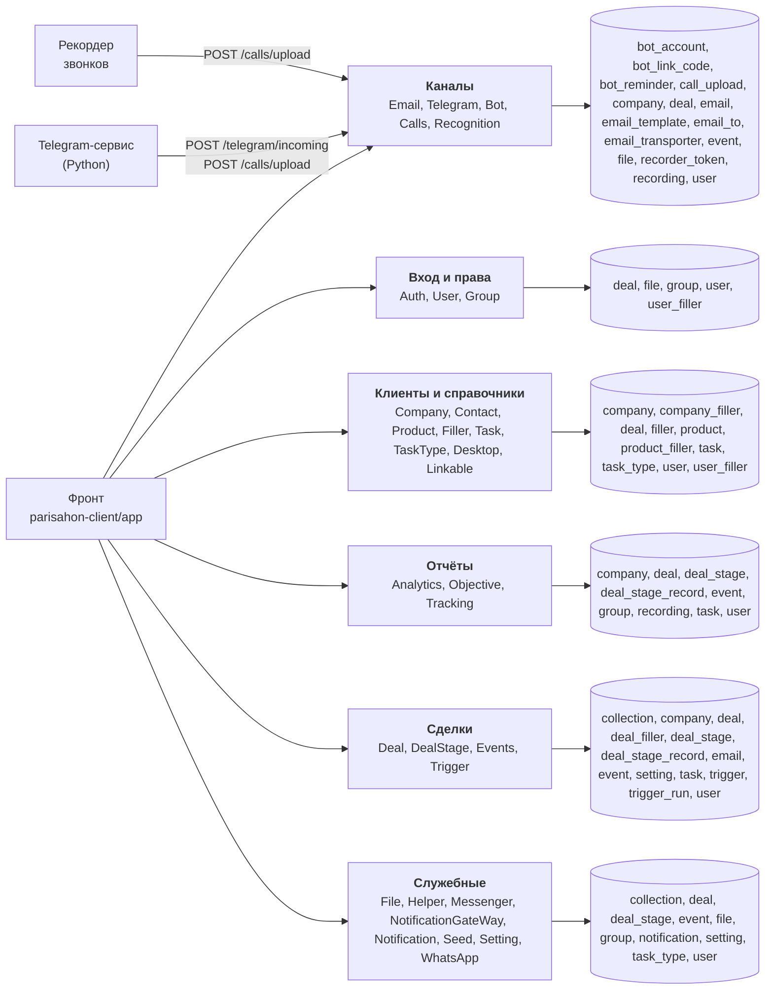
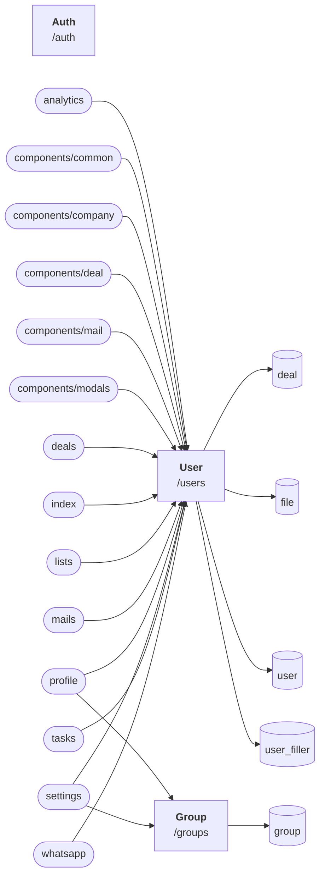
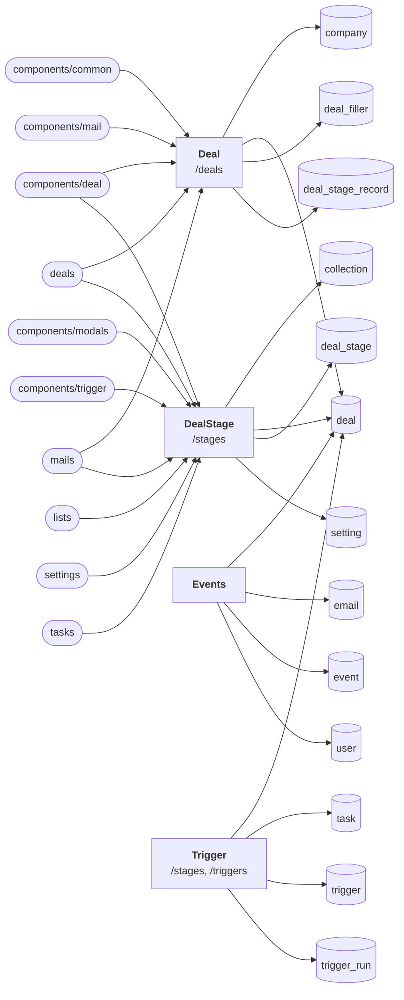
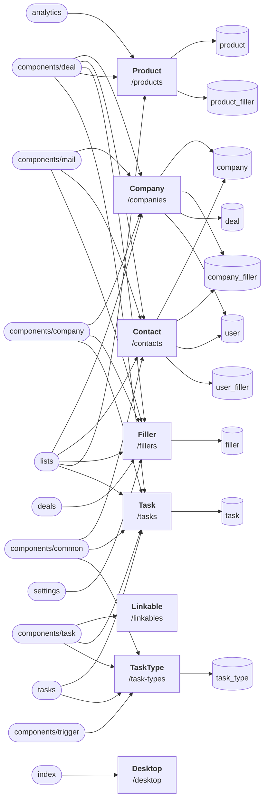
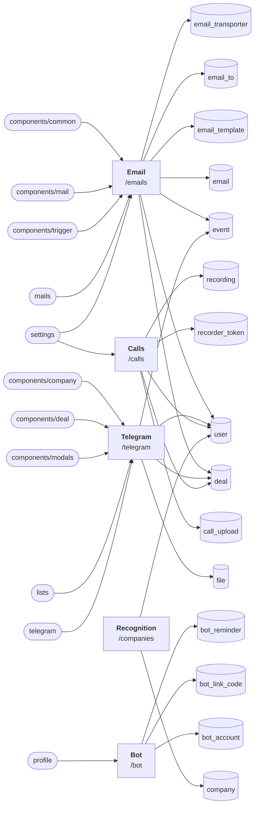
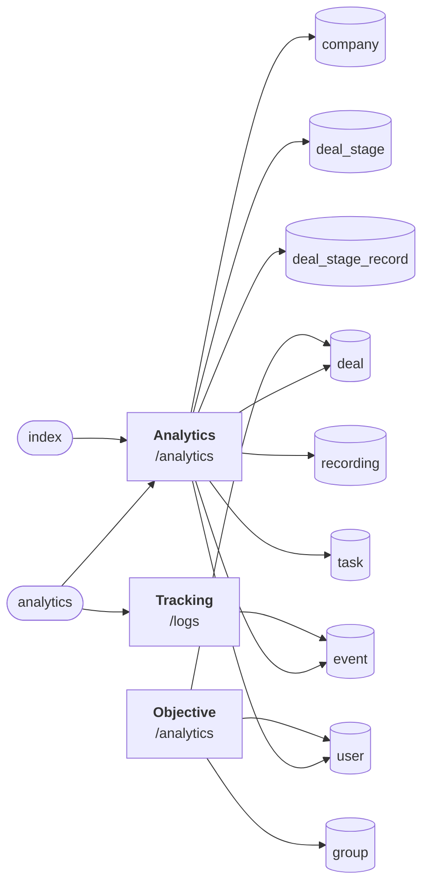
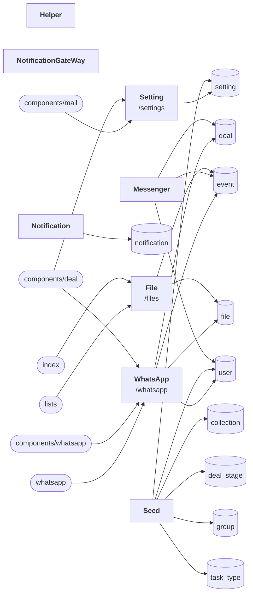
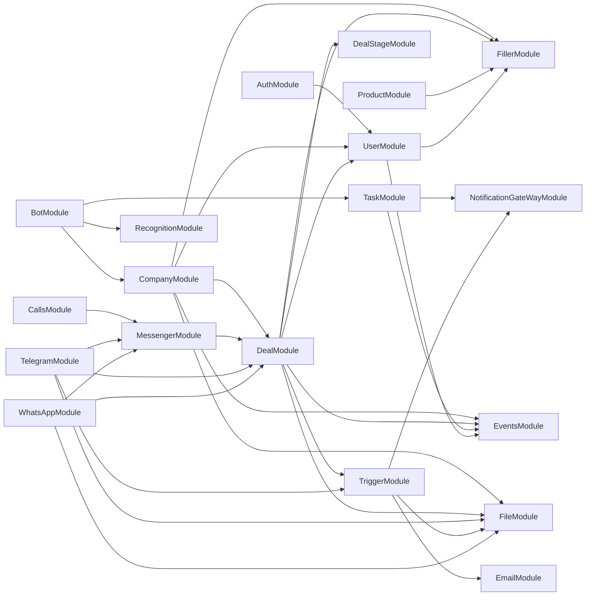
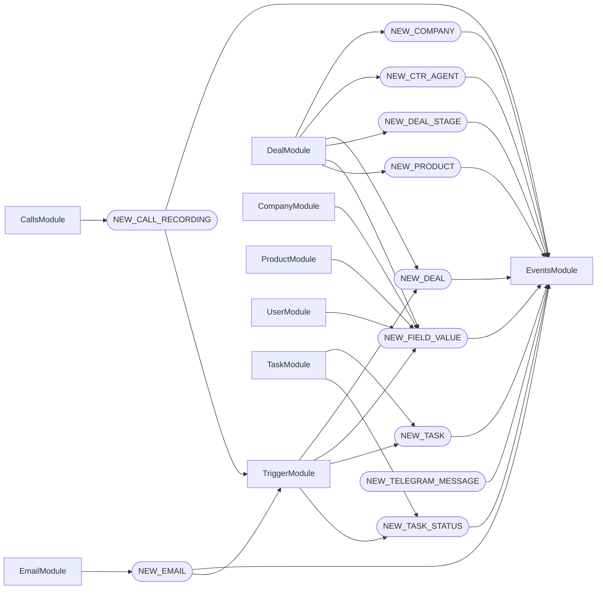
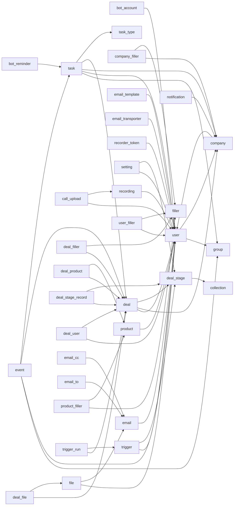

# Карта кода Parisa CRM

Сгенерировано `python3 local/dev/codemap.py` из исходников и dev-базы — не править руками. Как работать с модулями — `CLAUDE.md`.

## 1. Обзор: фронт → блоки API → таблицы

Блоки — группы модулей API по смыслу; цилиндр — таблицы блока.

### Блок «Вход и права»: страницы → модули → таблицы

### Блок «Сделки»: страницы → модули → таблицы

### Блок «Клиенты и справочники»: страницы → модули → таблицы

### Блок «Каналы»: страницы → модули → таблицы

### Блок «Отчёты»: страницы → модули → таблицы

### Блок «Служебные»: страницы → модули → таблицы

## 2. Зависимости модулей API

Стрелка: модуль импортирует другой модуль (Nest `imports`).

## 3. События между модулями

Модуль генерирует событие (`EventEmitter.emit`) → модули, которые его слушают (`@OnEvent`). Через события пишется история сделки и срабатывают триггеры.

## 4. Таблицы и внешние ключи

Стрелка: таблица ссылается на другую (внешний ключ).

## 5. Модули и проверки

| Модуль | Папка | Адреса API | Таблицы | Наборы проверок |
|---|---|---|---|---|
| Analytics | `parisahon-api/src/analytics` | /analytics | company, deal, deal_stage, deal_stage_record, event, recording, task, user | analytics, auth, smoke |
| Auth | `parisahon-api/src/auth` | /auth | — | auth, smoke |
| Bot | `parisahon-api/src/bot` | /bot/link, /bot/mcp | bot_account, bot_link_code, bot_reminder | auth, bot, smoke |
| Calls | `parisahon-api/src/calls` | /calls | call_upload, deal, recorder_token, recording, user | auth, calls, ftp, smoke |
| Company | `parisahon-api/src/company` | /companies | company, company_filler, deal, user | auth, modules, smoke |
| Contact | `parisahon-api/src/contact` | /contacts | company, company_filler, user, user_filler | auth, modules, smoke |
| Deal | `parisahon-api/src/deal` | /deals, /deals/trash | company, deal, deal_filler, deal_stage_record | auth, deals, smoke, trash |
| DealStage | `parisahon-api/src/deal_stage` | /stages | deal, deal_stage, collection, setting | auth, deals, smoke, trash |
| Desktop | `parisahon-api/src/desktop` | /desktop | — | auth, modules, smoke |
| Email | `parisahon-api/src/email` | /emails | deal, email, email_template, email_to, email_transporter, event, user | auth, mail, smoke |
| Events | `parisahon-api/src/events` | — | deal, email, event, user | deals, telegram, whatsapp |
| File | `parisahon-api/src/file` | /files | event, file | auth, files, platform, smoke |
| Filler | `parisahon-api/src/filler` | /fillers | filler | auth, modules, smoke |
| Group | `parisahon-api/src/group` | /groups | group | auth, platform, smoke |
| Helper | `parisahon-api/src/helper` | — | — | deals, trash |
| Linkable | `parisahon-api/src/linkable` | /linkables | — | auth, platform, smoke |
| Messenger | `parisahon-api/src/messenger` | — | deal, event, user | telegram, whatsapp |
| NotificationGateWay | `parisahon-api/src/gateway` | — | — | live |
| Notification | `parisahon-api/src/notification` | — | notification | — |
| Objective | `parisahon-api/src/objective` | /analytics/objectives | deal, group, user | analytics, auth, smoke |
| Product | `parisahon-api/src/product` | /products | product, product_filler | auth, modules, smoke |
| Recognition | `parisahon-api/src/recognition` | /companies | company, user | auth, bot, recognition, smoke |
| Seed | `parisahon-api/src/seed` | — | deal_stage, collection, group, setting, task_type, user | — |
| Setting | `parisahon-api/src/setting` | /settings | setting | auth, platform, smoke |
| Task | `parisahon-api/src/task` | /tasks | task | auth, modules, smoke |
| TaskType | `parisahon-api/src/task_type` | /task-types | task_type | auth, modules, platform, smoke |
| Telegram | `parisahon-api/src/telegram` | /telegram, /telegram/incoming | deal, event, file, user | auth, smoke, telegram |
| Tracking | `parisahon-api/src/tracking` | /logs | event | auth, platform, smoke |
| Trigger | `parisahon-api/src/trigger` | /stages/:id, /triggers | deal, task, trigger, trigger_run | auth, smoke, triggers |
| User | `parisahon-api/src/user` | /users | deal, file, user, user_filler | auth, modules, smoke |
| WhatsApp | `parisahon-api/src/whatsapp` | /whatsapp, /whatsapp/incoming | deal, event, file, user | auth, smoke, whatsapp |

Наборы для всего проекта: `schema` (база совпадает с кодом), `smoke` (каждый GET-запрос API), `ui` (каждая страница фронта), `auth` (права на всех маршрутах). Запуск: `local/dev/check.sh` (все) или `local/dev/check.sh --changed`.
